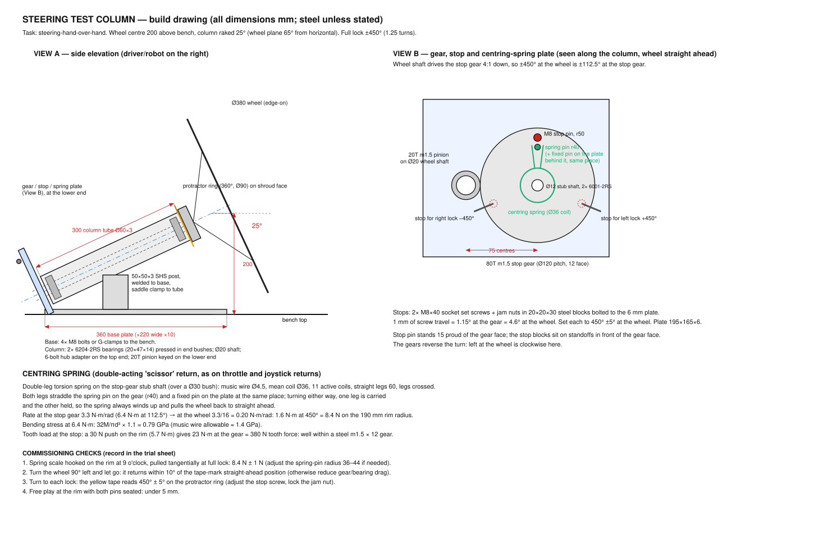

# steering-hand-over-hand

**Instruction:** "Turn the steering wheel all the way to the left, hold it there for two seconds, then let go and let it spring back to straight ahead."

A 380 mm steering wheel sits on a raked column on a bench test stand, with an instrument binnacle behind it. A 25 mm band of yellow marking tape on the rim marks 12 o'clock when the wheel is straight, and a white index line on top of the column shroud is the fixed reference it is read against. A torsion spring in the column pulls it back to straight ahead, standing in for a moving vehicle's self-centring. Full lock is 1.25 turns (450 deg) left. The wheel is turned hand over hand: one hand holds the rim against the spring while the other takes a new grip further round, and both hands are never off the rim together, or the wheel spins back. At the lock it is held for 2 s, then released, and the spring returns the wheel to straight ahead.

## Demo

Each hand pinches the 28 mm rim across its section, coming in from the driver's side along the column axis. The left hand works the lower-left arc of the rim and the right hand the right side. Per quarter turn:

1. Both hands carry the rim 90 deg round together.
2. The left hand lets go and takes a new grip 90 deg back, while the right hand holds the wheel against the spring.
3. The right hand does the same while the left holds.

Five strokes reach full lock. The hands carry the rim 93, 95, 97, 100 and 100 deg (the wheel lags the hands a little more as the spring winds up; the last stroke presses it onto its 450 deg stop). The grips sit 45 deg and 30 deg off the quarter points, so a spoke (at 3, 6 and 9 o'clock of the wheel) is never where a hand takes hold. At the lock both hands hold for 3 s, then let go and move clear, and the spring returns the wheel. The hands end the last stroke crossed over (the left at the lower right of the rim, the right at the upper left), as hand-over-hand steering does; the arms pass one above the other and never touch. To leave, each hand opens its jaws fully, backs straight off the rim 80 mm, goes round in front of the wheel 100 mm toward the robot (the left under it, the right over it, so the arms pass one above the other) to where it first took hold, and then out to its own side of the wheel, to a waiting pose about 200 mm from the rim and 150 mm nearer the robot than the wheel centre.

## Scoring

The turn is followed from the wheel's pose, unwrapped across full turns, positive to the left.

| Score | Condition (milestones latch) |
|---|---|
| 0.1 each | Quarter turn reached: 85, 175, 265, 355 deg |
| 0.6 | Full lock reached: 440 deg or more |
| 0.8 | Held at full lock for 2 s |
| 1.0 | Held, then let go: both hands 50 mm or more clear of the rim, and the wheel back at centre (within 10 deg of straight ahead) and at rest (under 1 cm/s and 0.2 rad/s) for 1 s |

While the wheel is being turned, a hand counts as on the rim when both of its finger pads lie within 6 mm of the rim's surface and its jaws are closed under 16 mm a side. The pads are measured from the joints at `station.BASES`. Two things count as a let-go:

- both hands off the rim for more than 0.15 s;
- the wheel slipping back more than 30 deg below the furthest it has been turned.

After a let-go, no hold credit is given (the score is capped at 0.6). These checks only observe; they trigger nothing in the simulation. A wheel torn off its column (hub moved more than 5 mm) is `dropped` and scores 0. The scorer returns `clear` and `dropped`.

**Real trial:** the rim's tape band, read against the shroud's index line and the protractor ring on the shroud face, gives the turn, including the return to within 10 deg of straight ahead; the hold, the release, the hands and any slip-back are seen on video.

## Real parts and build

The column, centring spring and stops are built from stock parts to the drawing [`drawings/column.svg`](drawings/column.svg) (all dimensions in mm; `drawings/make_drawing.py` regenerates it).



| Part | Specification |
|---|---|
| Wheel | 380 mm (15 in) three-spoke steering wheel, 28 mm leather-wrapped rim, about 1.4 kg; any 380 mm aftermarket wheel on a 6-bolt hub adapter. |
| Centre mark | A 25 mm band of yellow vinyl marking tape wrapped round the rim at 12 o'clock with the wheel straight, and a white paint line on top of the column shroud, as wheel-alignment shops mark a wheel. |
| Protractor ring | A printed 360 deg ring (90 mm), stuck on the shroud face behind the hub, zero at the index line. |
| Stand | 360 x 220 x 10 steel base plate, bolted (4 x M8) or G-clamped to the bench; a 50 x 50 x 3 square-tube post welded to it, with a saddle clamp holding the column tube at 25 deg rake, wheel centre 200 mm over the bench. |
| Column | 60 x 3 steel tube, 300 long; a 20 mm steel shaft on two 6204-2RS bearings (20 x 47 x 14) pressed into end bushes; the 6-bolt hub adapter on the top end and a 20-tooth module 1.5 steel spur gear keyed on the lower end. |
| Stop gear | An 80-tooth module 1.5 steel spur gear (120 mm pitch, 12 mm face) on a 12 mm stub shaft (two 6001-2RS bearings) in a 195 x 165 x 6 steel plate on the lower end of the tube, at 75 mm centres. The 4:1 reduction turns +/-450 deg (1.25 turns) at the wheel into +/-112.5 deg at the stop gear, so ordinary single-turn stops and an ordinary torsion spring do the work. |
| Stops (+/-450 deg) | An M8 pin standing 15 mm proud of the stop gear at 50 mm radius; two M8 x 40 socket set screws with jam nuts in 20 x 20 x 30 steel blocks on standoffs, set at +/-112.5 deg of the gear. Adjustment: 1 mm of screw travel is 4.6 deg at the wheel; set each lock to 450 +/- 5 deg on the protractor ring and lock the jam nut. |
| Centring spring | A double-leg torsion spring on the stub shaft (over a 30 mm bush): music wire 4.5 mm, 36 mm mean coil, 11 active coils, 60 mm straight legs, crossed. Both legs straddle a pin on the gear (40 mm radius) and a fixed pin on the plate at the same place ("scissor" return, as on throttle and joystick returns): turning either way, one leg is carried and the other held, so the spring always winds and pulls the wheel back to centre. Rate 3.3 N m/rad at the gear = 0.20 N m/rad at the wheel (divided by 4 squared), 1.6 N m at 450 deg; wire stress 0.79 GPa at full lock (music wire allows about 1.4 GPa). |
| Instrument binnacle | A dark moulded two-dial cluster housing behind the wheel; recognition only. |

**Commissioning checks** (recorded before each trial session):

1. A spring scale hooked on the rim at 9 o'clock and pulled tangentially at full lock reads 8.4 +/- 1 N (move the spring pin between 36 and 44 mm radius to adjust).
2. Turned 90 deg left and let go, the wheel comes back within 10 deg of straight ahead (otherwise reduce gear or bearing drag).
3. At each lock the tape reads 450 +/- 5 deg on the protractor ring.
4. Free play at the rim with both spring pins seated is under 5 mm.

The gear stage's inertia reflected to the wheel (about 0.0001 kg m^2) is under 1% of the wheel's, so the simulation applies the same spring and stops directly about the column axis (below).

## Simulation

- **Wheel:** one rigid body on a free revolute axle along the column axis, with damping and bearing friction. It moves only by finger contacts on its rim. Axle damping 0.06 N·m·s/rad, bearing friction 0.02 N·m; past ±450° the end stop adds 3.0 N·m/rad with 0.3 N·m·s/rad damping. No other damping is added.
- **Spring and stops:** PhysX revolute limits and drive targets both wrap at +/-180 deg. A test with limits set to -355/+180 stopped the wheel at -180. Neither can therefore hold a 1.25-turn spring or a 450 deg stop. The centring spring (K = 1.6 N m / 450 deg) and stiff end stops past 450 deg are applied by the task's `Dynamics` each control step, as a torque about the column axis computed from the measured, unwrapped turn.
- **Colliders:** the rim collider is 32 capsules round the 28 mm torus, under a drawn mesh. The hub and spokes also collide. The column, stand and binnacle are one fixed body. The tape band and the shroud's index line are drawn only: they add no collider and no mass.
- **Simplification:** a moving vehicle's self-centring (from caster and tyre forces) is stood in for by the torsion spring.
- **Forces:** at full lock the spring needs about 9 N tangential at the rim. That is within one pinching hand's friction (two pads at about 18 N each).

## Reproduction

Run from the folder that contains this task, writing outputs outside it:

```
python3 steering-hand-over-hand/run.py --output ../steering-hand-over-hand-outputs
```
